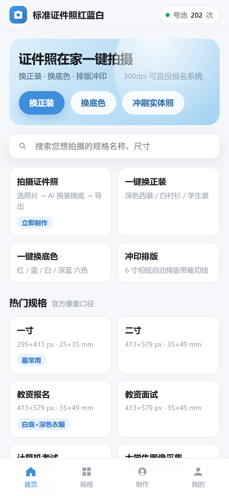
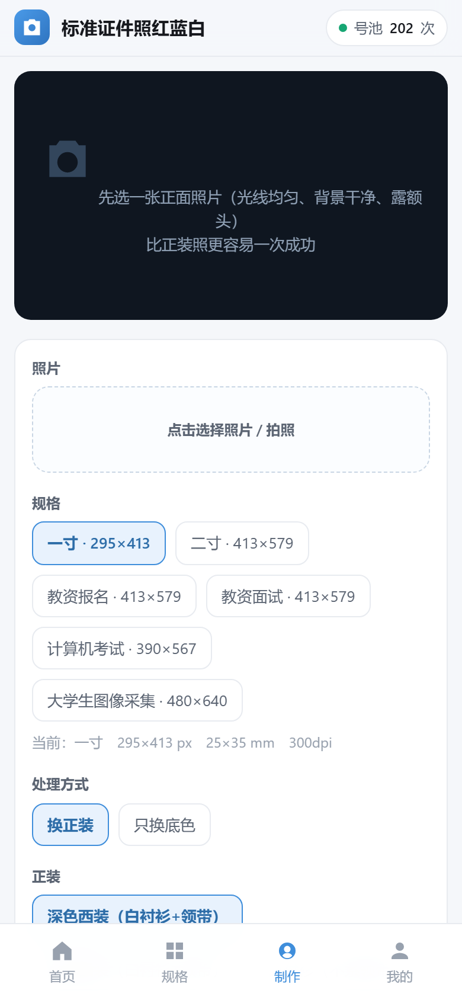

# 证件照 H5（复刻《标准证件照红蓝白》，换正装走 chatgpt2api 生图）

原小程序的逆向结论（包格式、加密算法、接口面、落地页清单）另存文档，不在本仓库内。
这一份是可直接跑的 **H5 版本**：纯静态前端 + 一个 Node 本地服务，换正装用本机号池的 `gpt-image-2` 做参考图编辑，
构图裁剪 / 底色 / 300dpi / 冲印排版全在浏览器本地完成。

| 首页 | 制作页 |
|---|---|
|  |  |

- 打开地址：**http://127.0.0.1:8088**
- 起服务：`node server.mjs`（或 `npm start`）
- 生图前提：DSH 在跑（`127.0.0.1:38650` 有 python 进程）+ 代理开着（`127.0.0.1:7890`）

---

## 一、这一版做了什么

| 原小程序 | 这一版 |
|---|---|
| 首页：换正装 / 换底色 / 冲刷实体照 三个入口 | 保留三个入口，第三个改为「排版冲印」（本地 6 寸相纸排版） |
| 规格搜索 + 热门规格 + 分类 | 保留，15 个规格，px/mm/ppi 用官方口径 |
| 拍照页 / 制作页 / 制作中页 / 预览页 | 合并成一页：选图 → 选项 → 生成 → 导出 |
| 云端 AI 换正装（黑盒） | **本机 chatgpt2api `gpt-image-2` 参考图编辑**，提示词可控、可复现 |
| 本地换底色（纯色值） | 保留，底色合进同一个生成提示词（一步出图），另可只裁剪原图导出 |
| 300dpi / 排版 / 打印 | 保留：JPEG 里写真实 300dpi；6 寸相纸 5×3=15 张 1 寸带裁切线 |
| 广告位（mp-ad×N、adunit banner、插屏） | **全删** |
| 登录 / open_id / 会员 / 点数 / 付费引导弹窗 | **全删**（`config.json` 里开关默认 `false`） |
| 微信支付 / iOS 虚拟支付分支 | **全删**（保留 appId / mchId 空位） |

### 删掉的广告与会员部件清单

原包里这些部件在这版里一个都没有：

- `components/mp-ad`（小程序广告位）、各处 `adunit-883eca23713634dd` / `adunit-975231795c0e8cc4`
- 首页与制作页的「广告」角标、插屏广告（`wx.createInterstitialAd`）
- `components/guide-gzh`（关注公众号引导）、`guide-score` / `guide-add`（好评/添加引导）
- `components/popup-recall`（离开召回弹窗）、`popup-coupon`（优惠券弹窗）
- `components/remake-pay-guide` + `callback`（重制付费引导）、`components/ios-pay`、`popup-vip`（会员墙）
- 所有 `wx.request` 里的 `statics_pages/point_record`（点数/埋点）与会员价目逻辑

现在页面里没有任何第三方广告脚本、没有弹窗召回、没有付费墙，打开就能生成。

---

## 二、目录

```
h5/
├─ server.mjs              本地服务 + 公网 API：静态站 / 同步 /api/generate / 异步 /v1/jobs
├─ router.mjs              公网分流：/idphoto/* → 8088，其余 → 38650（一个 ngrok 端点服务两个服务）
├─ config.json             appId / mchId 空位 + 功能开关 + 限流配置（key 不在这里）
├─ api-keys.json           ★ 公网 API 密钥，gitignore，不入库
├─ lib/jpeg.mjs            PNG→JPEG 压缩（ngrok 带宽只有 ~30KB/s，必须压）
├─ public/
│  ├─ index.html           壳 + 底部 tabbar
│  ├─ css/app.css
│  └─ js/
│     ├─ specs.js          15 个规格 / 6 种底色 / 5 套正装 / 提示词构造
│     ├─ compose.js        构图裁剪（头高 62%、头顶留白 9%）+ JPEG 300dpi + 冲印排版
│     └─ app.js            hash 路由 + 四个视图 + 生成/导出流程
├─ scripts/start.ps1       一键起 8088 + 8090 + ngrok，打印公网 base 和 key 前缀
├─ scripts/stop.ps1        全停（含 38650 的公网入口）
├─ test_generate.mjs       不走浏览器，直接打 /api/generate 验证后端链路
├─ tools/
│  ├─ public_api_client.mjs  公网 API 客户端：提交任务→轮询→取图
│  ├─ cdp_test.mjs         无头 Chrome(CDP) 跑完整链路：选图→生成→截图→导出→校验
│  ├─ probe_layout.mjs     量视口/grid 轨道，排查横向溢出
│  └─ shot_mobile.mjs      390×844@2x 手机视口截图
└─ outputs/                生成结果落盘（前端只拿 URL）
```

---

## 三、换正装是怎么实现的（参考 session-ee201ec6 的做法）

一条 `POST /api/generate` 走完，服务端把它翻译成 chatgpt2api 的参考图编辑：

```
POST http://127.0.0.1:38650/v1/images/edits
Authorization: Bearer <~/.dsh/chatgpt2api-native/admin-key>
{
  "model": "gpt-image-2",
  "prompt": "…",
  "n": 1,
  "response_format": "b64_json",
  "size": "1024x1536",
  "images": [{ "b64_json": "<照片>", "mime_type": "image/jpeg", "filename": "reference-1.jpg" }]
}
```

`server.mjs` 里把超时放到 **420s**（默认 240s 在号池排队时必挂，这是上个会话踩过的坑），
结果落盘 `outputs/`，只把 `/outputs/xxx.png` 的 URL 回给前端。

### 提示词（`public/js/specs.js: buildPrompt`）

三段固定 + 两个可选，都是上个会话实测能过审、且保脸的写法：

```
同一张照片的证件照处理；
[服装换成深色西装外套，内搭白色衬衫并系深色领带]；   ← 换装模式才有
背景替换为纯蓝色，无渐变、无阴影、无纹理；
正面免冠，双肩平齐，面部居中，头顶留白自然，光线均匀；
五官比例与本人一致，保留真实皮肤质感，不做美颜、不瘦脸、不放大眼睛；
[上唇与下巴的胡须阴影清理干净，肤色自然、没有胡青]；  ← 勾了“清理胡渣”
[发型整理清爽服帖、露出额头，发丝不油腻不翘起]        ← 勾了“整理发型”
```

要点（照抄原会话的经验）：

1. **框成「证件照处理」**，别写「保持这个人不变 / 不要换人」——身份强约束会触发上游内容策略。
2. **必须写「五官比例与本人一致 / 保留真实皮肤质感 / 不做美颜」**，否则模型会顺手磨皮瘦脸。
3. **一次只改一类事**；换装 + 底色可以合并，但「局部微调」（胡渣、发丝）留给第二轮，避免脸被一起改掉。
4. 单张 40~90s 是正常值；号池被别的任务占用时会到 100s+。

### 第二轮「局部精修」（`buildRefinePrompt`）

出图后点「局部精修」，前端拿**上一版结果**（不是原图）当参考图再发一次，提示词只描述要动的那一两处：

```
同一张证件照的局部微调；
把上唇与下巴的胡须阴影彻底清理干净，肤色自然、没有胡青；把两侧头发整理得更服帖整齐；
其他全部保持不变：背景颜色、服装、领带、面部五官与比例、构图与裁切范围；
保留真实皮肤质感，不做美颜、不瘦脸、不放大眼睛
```

关键：**锁住「其余不变」**。实测第一轮 41.8s、第二轮 46.8s，胡表阴影基本清干净。

### 出图之后的本地处理（`compose.js`）

1. `analyzeFraming()`：把图缩到 240px 宽，用左上角像素当背景色，主体=与背景距离>60 的像素；
   第一行主体像素够多的位置 = 发顶；眼鼻一带的水平质心 = 人脸中心。
2. `cropToSpec()`：`头高 = 下巴-发顶`，`cropH = 头高 / 0.62`，`cropW = cropH × 规格宽高比`，
   `top = 发顶 - 0.09 × cropH`，按人脸中心水平居中 → 直接画到 `spec.px` 尺寸。
3. `patchJpegDpi()`：往 JPEG 的 JFIF APP0 里写 `units=1, X=300, Y=300`。
   浏览器 canvas 导出默认是 72dpi，报名系统会按 72dpi 算物理尺寸，必须补这一步。
4. `buildSheet()`：6 寸相纸 1800×1200，5×3 排 1 寸，带 1px 裁切参考线。

---

## 四、验证过的结果（本机实跑）

| 项 | 结果 |
|---|---|
| `/api/status` | `reachable:true, active:9, quota:202`（本轮共消耗 2 次额度） |
| 直接打接口（`test_generate.mjs`） | **36.0s** 出图 1.6MB，蓝底 + 深色西装 + 白衬衫 + 领带 |
| 浏览器全链路（`tools/cdp_test.mjs`） | 选图 OK → 生成 **61.9s** → 截图 → 导出下载 OK |
| 导出文件 | `一寸_295x413_300dpi_AI.jpg`，**295×413 px，DPI (300,300)**，20KB |
| 构图自检 | `hairTop=230, headH=845, cx=510`（原图 1024×1536） |
| 前端 `analyzeFraming` + `cropToSpec` + DPI 补丁 | JFIF 校验通过，`dpiUnits=1, dpiX=300, dpiY=300` |
| 交互回归 | 「换正装 ⇄ 只换底色」切换后按钮文案/正装区块/底色选中态均正确，无横向溢出（390×844 下 `scrollWidth=390`） |

### 真实自拍实测（1080×1920，室内杂背景，有胡渣）

`node tools/cdp_test.mjs "<照片>" real2 refine` —— 两轮法，全程浏览器操作：

| 步骤 | 结果 | 耗时 |
|---|---|---|
| 第一轮 换装+换底 | 深色西装 + 白衬衫 + 藏青领带 + 纯蓝底，五官/脸型/发际线保留 | **41.8s** |
| 第二轮 局部精修（以第一轮结果为参考图） | 上唇胡表阴影基本清干净、两侧发丝更服帖 | **46.8s** |
| 构图自检 | `hairTop=213, headH=845, cx=508`（源图 1024×1536） | — |
| 导出 一寸 | `295×413`，dpi `300,300`，30KB | — |
| 导出 二寸 | `413×579`，dpi `300,300`，52KB | — |
| 导出 6 寸排版 | `1800×1200`，dpi `300,300`，15 张 1 寸带裁切线 | — |

合计消耗 **2 次号池额度**（剩余 186）。

界面截图：`docs/screenshot-home.png`、`docs/screenshot-make.png`、`docs/screenshot-desktop.png`。
真实人脸的处理效果图不入库（涉及肖像，跑一次本地就有了）。

结论：一轮就能出可用证件照；胡渣/发丝这类细节建议走第二轮精修，且**第二轮必须拿第一轮结果当参考图**，
否则模型会连脸一起重画。第二轮会稍微增加磨皮感，如果报名系统要求"原始肤质"，就到第一轮为止。


---

## 五、公网 API（异步任务式）

本机这套生图后端现在有一个公网入口，形状照本机 ComfyUI 的
`POST /prompt` → `GET /history/{id}` → `GET /view?filename=` 来的：**提交任务 → 轮询 → 取图**。
单张 40~90s，公网长连接容易被代理/移动网络掐断，异步比同步稳。

```
公网 base：https://propeller-flattery-feminism.ngrok-free.dev/idphoto
鉴权     ：Authorization: Bearer <api-keys.json 里的 key>
```

### 接口

| 方法 | 路径 | 说明 |
|---|---|---|
| GET | `/api/health` | 后端是否在线 + 号池剩余额度 + 限流档位 |
| POST | `/v1/jobs` | 提交生成任务，`202 {job_id, poll_url}` |
| GET | `/v1/jobs/{id}` | `pending` / `running` / `succeeded` / `failed` |
| GET | `/files/{name}` | 取图（`result.url` 是 PNG，`result.jpeg_url` 是压缩版） |
| POST | `/api/generate` | 同步版（H5 用，本机同源不校验 key） |

提交体：

```json
{
  "image": "data:image/jpeg;base64,...",   // 也支持 http(s) 图片地址
  "prompt": "同一张照片的证件照处理；服装换成深色西装外套…",
  "size": "1024x1536"
}
```

查询结果：

```json
{
  "ok": true, "job_id": "job_xxx", "status": "succeeded", "elapsed_ms": 45000,
  "result": {
    "url": "https://.../idphoto/files/xxx.png", "bytes": 2056955,
    "jpeg_url": "https://.../idphoto/files/xxx.jpg", "jpeg_bytes": 191491
  }
}
```

### 现成客户端

```bash
node tools/public_api_client.mjs <照片> https://propeller-flattery-feminism.ngrok-free.dev/idphoto <key>
```

实测（1080×1920 自拍压到 720×1280，蓝底西装）：

| 阶段 | 耗时 |
|---|---|
| 提交 → `running` | ~25s |
| `running` → `succeeded` | 共 **45s** |
| 下载 JPEG（187KB） | 6.4s |
| 下载 PNG（2.0MB） | 52s |

**所以公网一定优先用 `jpeg_url`**：ngrok 免费通道实测只有 ~30KB/s，2MB 的 PNG 要 52s，200KB 的 JPEG 6s 就完了。
服务端出图后会自动压一张 q88 的 JPEG（`lib/jpeg.mjs`，用本机 Pillow，193ms），两个地址一起返回。

### 限流

| 档 | 默认 | 配置项 |
|---|---|---|
| 生成 | 6 次/分钟，80 次/天 | `config.json → api.rateLimit.perMinute / perDay` |
| 轮询/取图 | 120 次/分钟 | `config.json → api.rateLimit.pollPerMinute` |

轮询单独一档：客户端每 3s 查一次，20 次/分钟，跟生成抢额度会把自己限死（这个坑实测踩过）。

### 为什么是 `/idphoto` 前缀 + 一个 router

ngrok 免费账号的 dev 域名是**账号级唯一**的。再起 `ngrok http 8088` 会撞：

```
ERR_NGROK_334 The endpoint 'https://propeller-flattery-feminism.ngrok-free.dev' is already online
```

所以没有新开隧道，而是把已有端点接到 `router.mjs`（:8090）上按路径分流：

```
ngrok → router:8090
          ├─ /idphoto/*  → 127.0.0.1:8088   （本项目）
          └─ 其它        → 127.0.0.1:38650  （原有 chatgpt2api，路径完全不变）
```

原来 `https://propeller-flattery-feminism.ngrok-free.dev/v1/models`、`/health` 这些照旧可用，已验证。

### 起停

```powershell
powershell -ExecutionPolicy Bypass -File scripts\start.ps1   # 起 8088 + 8090 + ngrok
powershell -ExecutionPolicy Bypass -File scripts\stop.ps1    # 全停（含 38650 的公网入口）
```

### 密钥

- 只存在 `api-keys.json`（**已 gitignore**），或环境变量 `IDPHOTO_API_KEYS`（逗号分隔多个）。
- 换 key：改文件 → 重启 `server.mjs`。
- 仓库里不含任何 key；`config.json` 只有限流和 CORS 配置。

---

## 六、接自己的 AppID / 商户号

全在 `config.json`，当前一律留空、功能开关全关：

```json
{
  "features": { "login": false, "vip": false, "ads": false, "payment": false, "print": false },
  "wechat":  { "appId": "", "mchId": "" }
}
```

接自己的号时分三步：

1. 填 `wechat.appId` / `wechat.mchId`。
2. 服务端补两个接口（`server.mjs` 里已留路由名）：
   - `wechat.jsapiTicketEndpoint`：拿 `access_token` → `jsapi_ticket` → 给前端算 `wx.config` 签名；
   - `wechat.payEndpoint`：`JSAPI 下单`（`/v3/pay/transactions/jsapi`）+ 支付结果回调。
3. 想开哪个功能就把 `features` 里对应项改成 `true`，前端已按开关渲染（`我的` 页会显示「已禁用/已启用」）。

**注意**：`/api/generate` 现在没有任何鉴权与配额控制，只监听 `127.0.0.1`。
如果要放到公网（公众号 H5 / 小程序 web-view），至少先做三件事：
① 服务端加会话/频率限制（否则等于把号池送人）；② 图片上传落盘别落成公开目录；
③ 把 `outputs/` 的访问加签名或改成反向代理内部路径。

---

## 七、已知限制

**公网相关**

- /files/* 不需要 key：结果图靠「时间戳 + 8 位随机 hex」当口令，拿到 URL 就能下。
  正式对外开放前建议改成签名 URL（HMAC + 过期时间），或者取图也套 Bearer。
- outputs/ 不会自动清理：一张 2MB，跑多了会堆。生产上定时清或直接落对象存储（OSS/COS/S3）。
- 任务表在单实例内存里：/v1/jobs 的记录重启即丢（结果文件还在）。要多实例得换 Redis。
- ngrok 免费通道带宽 ~30KB/s 且域名是账号级的：并发一高就排队，正式用要换付费隧道或自有域名反代。

**产品相关**

1. **单张一次生成**：改底色/换装都要重新出图（1 次额度）。省额度可以走「只裁剪原图导出」。
2. **模型偏好长构图**：1024x1536 是最接近证件照比例的竖图尺寸；再方的尺寸它会自己补背景。
3. **不做美颜**：提示词明确禁了美颜；想好看点就把最后一句改成中性描述（但会影响"真实"）。
4. **构图依赖背景干净**：nalyzeFraming 用左上角像素当背景色，纯色底成片没问题；
   用户上传复杂背景原片又直接裁剪的话，要先走一次 AI 换底色。
5. **没有服务端历史/订单**：outputs/ 只是本次生成的文件，没有列表页。